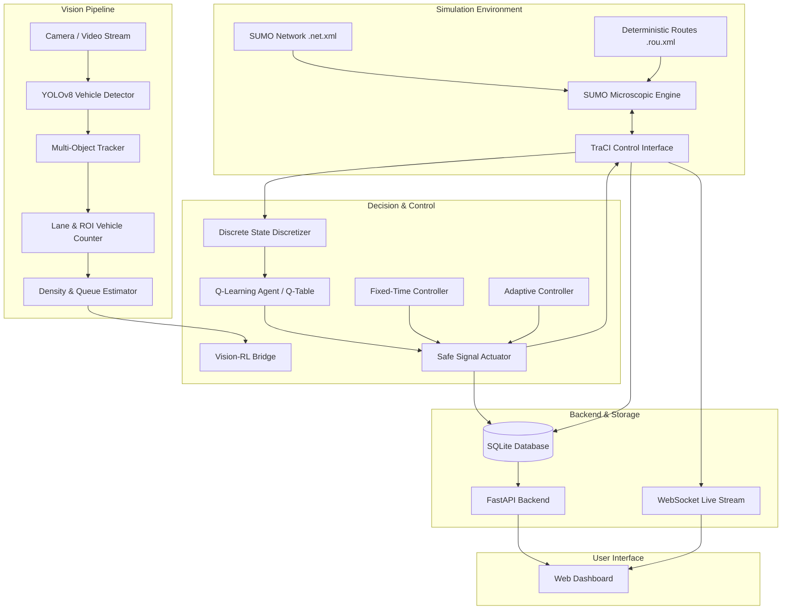

# GREENWAVE System Architecture

GREENWAVE integrates Computer Vision, Reinforcement Learning, Microscopic Traffic Simulation, and Real-Time Web Telemetry into a modular, testable system.

## Layer Descriptions

### 1. Vision Pipeline (`vision/`)
* **`detector.py`**: Wraps Ultralytics YOLOv8 for batched or single-frame detection of vehicles (`car`, `motorcycle`, `bus`, `truck`) with Apple Silicon MPS / CUDA / CPU acceleration.
* **`tracker.py`**: Implements dual-stage IoU and Euclidean centroid tracking with trajectory history to prevent double-counting.
* **`counter.py`**: Computes total unique vehicles, class distributions, and lane/region-wise counts using polygon containment tests.
* **`traffic_density.py`**: Computes normalized continuous density scores ($0.0 \to 1.0$) and categorical levels (`LOW`, `MEDIUM`, `HIGH`) and estimates queue length in meters from stoplines.

### 2. Simulation Environment (`sumo/`)
* **`build_network.py`**: Automatically compiles a 4-way signalized intersection with 2 lanes per approach using SUMO `netconvert`.
* **`route_generator.py`**: Generates reproducible vehicle routes across 5 traffic demand regimes (`low`, `medium`, `high`, `unbalanced`, `peak`).
* **`simulation.py`**: Controls SUMO step-by-step via TraCI, collects queue and waiting telemetry, and enforces signal safety constraints (minimum green durations, yellow transition phases).

### 3. Reinforcement Learning Engine (`reinforcement_learning/`)
* **`state.py`**: Discretizes continuous queues and signal timers into a compact 128-state tuple `(ns_queue, ew_queue, phase, duration_bucket)`.
* **`q_learning.py`**: Pure Python tabular Q-Learning agent implementing the Bellman optimality update equation.
* **`reward.py`**: Scalar reward function balancing queue reduction, waiting time reduction, throughput reward, and signal switch penalties.
* **`train.py`**: Multi-episode training pipeline producing `models/q_table.json` and training convergence plots.

### 4. Backend & Web Dashboard (`backend/`, `dashboard/`)
* **FastAPI Backend**: REST endpoints for simulation controls, metrics, and SQLite experiment queries.
* **WebSocket Server**: Streams live intersection telemetry at 5 Hz to the web dashboard.
* **Single-Page Dashboard**: Visualizes 4-way animated traffic signals, live queue meters, Chart.js time-series plots, and comparison tables.
